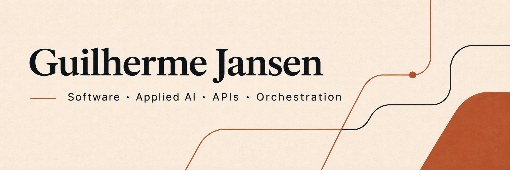

[Português](README.pt-BR.md) · [English](README.md) · [Español](README.es.md)

# Integraciones que funcionan en conjunto

Desarrollador full stack con Go, Python, TypeScript y Rust. Trabajo en APIs, integraciones de IA e interfaces de aplicaciones.

## Proyectos seleccionados

- [Better Auth Waitlist](https://github.com/guilhermejansen/better-auth-waitlist) — Plugin de lista de espera incluido en el catálogo comunitario de Better Auth; no es una modificación del núcleo de autenticación.
- [WhatsApp Flows Server](https://github.com/guilhermejansen/whatsapp-flows-server) — Backend TypeScript para intercambio de datos y webhooks de WhatsApp Flows.
- [Whats Convert API](https://github.com/guilhermejansen/whats-convert-api) — API en Go para conversión de medios e integración con almacenamiento compatible con S3.

## Proyecto destacado

**Host Orchestrator** — Núcleo Rust para contexto, comandos y artefactos de agentes.

Persistencia local de conversaciones, comandos, contexto y artefactos en SQLite, con servicios HTTP y CLI en Rust.

Separación entre conversaciones lógicas y sesiones nativas de los proveedores; registro de intención y resultados inciertos sin repetición automática.

Rust · Tokio · Axum · SQLite · React · TypeScript

## Código abierto

- [Horizon · contribución en Rust](https://github.com/horizon-rust/horizon/pull/5484) — Corrección integrada para preservar la aplicación macOS durante las actualizaciones del launcher.
- [WuzAPI · contribuciones upstream](https://github.com/asternic/wuzapi/pull/70) — Contribuciones integradas en gestión de grupos, Docker/Compose y conectividad con bases de datos.
- [WuzAPI #73](https://github.com/asternic/wuzapi/pull/73) · [#77](https://github.com/asternic/wuzapi/pull/77) · [Better Auth #7889](https://github.com/better-auth/better-auth/pull/7889)

## Tecnologías

**Backend e IA:** Python · FastAPI · LangGraph · Go · Ruby on Rails · APIs REST · Webhooks · n8n

**Interfaces:** TypeScript · JavaScript · React · Next.js · Vue · HTML · CSS

**Sistemas y operación:** Rust · Tokio · Axum · SQLite · PostgreSQL · Redis · Docker · Git · CI/CD

## Idiomas

Portugués nativo. Inglés y español básicos.

Interés en puestos presenciales e híbridos en toda España y remotos en Europa. Disponibilidad y autorización de trabajo a concretar para cada puesto.

## Contacto

[Portfolio](https://guilhermejansen.com.br) · [LinkedIn](https://www.linkedin.com/in/guilhermejansenoficial/) · [Email](mailto:guilhermejansenoficial@gmail.com)

