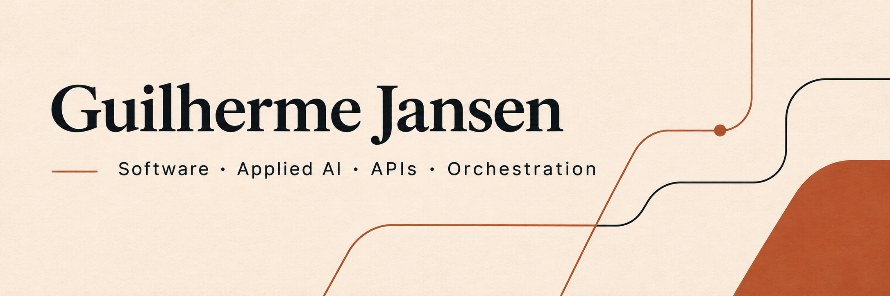

[Português](README.pt-BR.md) · [English](README.md) · [Español](README.es.md)

# Building integrations that work together

Full-stack developer working with Go, Python, TypeScript and Rust. I build APIs, AI integrations and application interfaces.

## Selected projects

- [Better Auth Waitlist](https://github.com/guilhermejansen/better-auth-waitlist) — Waitlist plugin, listed in the Better Auth community catalog; not a change to the authentication core.
- [WhatsApp Flows Server](https://github.com/guilhermejansen/whatsapp-flows-server) — TypeScript backend for WhatsApp Flows data exchanges and webhooks.
- [Whats Convert API](https://github.com/guilhermejansen/whats-convert-api) — Go API for media conversion and S3-compatible storage integration.

## Project in focus

**Host Orchestrator** — Rust core for agent context, commands and artifacts.

Local persistence of conversations, commands, context and artifacts in SQLite, with HTTP services and a Rust CLI.

Logical conversations remain separate from native provider sessions; durable intent records and uncertain outcomes without automatic replay.

Rust · Tokio · Axum · SQLite · React · TypeScript

## Open source

- [Horizon · Rust contribution](https://github.com/horizon-rust/horizon/pull/5484) — Merged fix preserving the macOS application during launcher updates.
- [WuzAPI · upstream contributions](https://github.com/asternic/wuzapi/pull/70) — Merged contributions covering group management, Docker/Compose and database connectivity.
- [WuzAPI #73](https://github.com/asternic/wuzapi/pull/73) · [#77](https://github.com/asternic/wuzapi/pull/77) · [Better Auth #7889](https://github.com/better-auth/better-auth/pull/7889)

## Technologies

**Backend and AI:** Python · FastAPI · LangGraph · Go · Ruby on Rails · REST APIs · Webhooks · n8n

**Interfaces:** TypeScript · JavaScript · React · Next.js · Vue · HTML · CSS

**Systems and operations:** Rust · Tokio · Axum · SQLite · PostgreSQL · Redis · Docker · Git · CI/CD

## Languages

Native Portuguese. English and Spanish: basic.

Open to on-site and hybrid opportunities across Spain, and remote opportunities in Europe. Availability and work authorization to be discussed for each role.

## Contact

[Portfolio](https://guilhermejansen.com.br) · [LinkedIn](https://www.linkedin.com/in/guilhermejansenoficial/) · [Email](mailto:guilhermejansenoficial@gmail.com)

