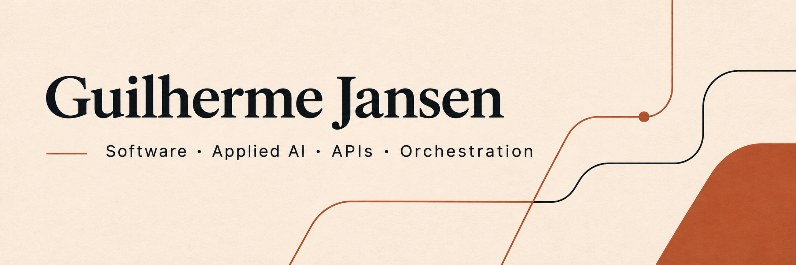

[Português](README.pt-BR.md) · [English](README.md) · [Español](README.es.md)

# Integrações que funcionam em conjunto

Desenvolvedor full stack com Go, Python, TypeScript e Rust. Trabalho em APIs, integrações de IA e interfaces de aplicações.

## Projetos selecionados

- [Better Auth Waitlist](https://github.com/guilhermejansen/better-auth-waitlist) — Plugin de lista de espera. Inclusão no catálogo comunitário do Better Auth; não é uma alteração no núcleo de autenticação.
- [WhatsApp Flows Server](https://github.com/guilhermejansen/whatsapp-flows-server) — Backend TypeScript para troca de dados e webhooks do WhatsApp Flows.
- [Whats Convert API](https://github.com/guilhermejansen/whats-convert-api) — API em Go para conversão de mídia e integração com armazenamento compatível com S3.

## Projeto em foco

**Host Orchestrator** — Núcleo em Rust para contexto, comandos e artefatos de agentes.

Persistência local de conversas, comandos, contexto e artefatos em SQLite, com serviços HTTP e CLI em Rust.

Separação entre a conversa lógica e as sessões nativas dos provedores; registro de intenção e resultados incertos sem replay automático.

Rust · Tokio · Axum · SQLite · React · TypeScript

## Código aberto

- [Horizon · contribuição em Rust](https://github.com/horizon-rust/horizon/pull/5484) — Correção integrada para preservar o aplicativo macOS durante atualizações do launcher.
- [WuzAPI · contribuições upstream](https://github.com/asternic/wuzapi/pull/70) — Contribuições integradas em gestão de grupos, Docker/Compose e conectividade com banco de dados.
- [WuzAPI #73](https://github.com/asternic/wuzapi/pull/73) · [#77](https://github.com/asternic/wuzapi/pull/77) · [Better Auth #7889](https://github.com/better-auth/better-auth/pull/7889)

## Tecnologias

**Backend e IA:** Python · FastAPI · LangGraph · Go · Ruby on Rails · APIs REST · Webhooks · n8n

**Interfaces:** TypeScript · JavaScript · React · Next.js · Vue · HTML · CSS

**Sistemas e operação:** Rust · Tokio · Axum · SQLite · PostgreSQL · Redis · Docker · Git · CI/CD

## Idiomas

Português nativo. Inglês e espanhol básicos.

Interesse em oportunidades presenciais e híbridas em toda a Espanha e remotas na Europa. Disponibilidade e autorização de trabalho a alinhar para cada vaga.

## Contato

[Portfolio](https://guilhermejansen.com.br) · [LinkedIn](https://www.linkedin.com/in/guilhermejansenoficial/) · [Email](mailto:guilhermejansenoficial@gmail.com)

